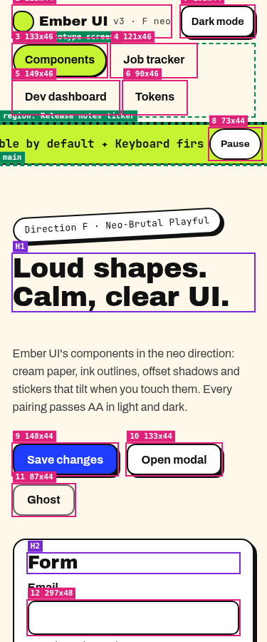
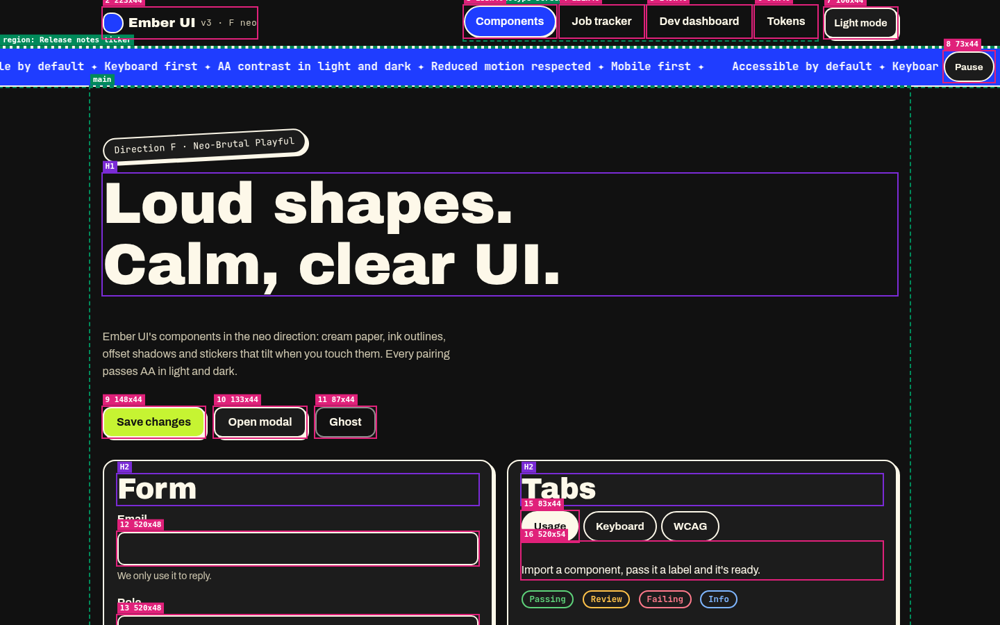

# Progress

Dated log of how Ember UI was built. Screenshots are in `docs/screenshots/`.

## 2026-11-10

- Project picked as UX case study 1 of 3: an accessible design system starter.
- Plan and DONE criteria written: tokens in one file (light and dark), 8 components with every state, live Storybook with usage, keyboard and WCAG notes on each docs page, axe 0 serious or critical on every story, unit tests for Modal focus return, Tabs keys and Toast roles.
- Design spec v1.0: tokens seeded from jdilig.me so the system and the site match; native-first components (`<dialog>`, `<select>`); fixed docs page order.
- Tokens built: raw palette plus a semantic layer. Status colors chosen for AA contrast in both themes. The Tokens page computes live contrast ratios for every documented pair.
- Components built: Button, Input, Select, Checkbox, Modal, Tabs, Table, Toast. Shared field shell for labels, hints, required markers and errors wired with `aria-describedby`.
- Unit tests: 6 passing (Modal Esc and close-button focus return, Tab trap, Tabs keys, Toast roles, Toast hover pause).
- First full axe sweep found serious issues only on docs pages (Storybook chrome contrast, the Controls JSON editor, and the token table picking up docs-page styles). Fixed: read-only ArgTypes table, darker docs link and code colors, `sb-unstyled` on the token sheet, themed story backgrounds in docs. Result: 120 runs (49 stories and 11 docs pages, light and dark), 0 serious or critical; reduced-motion check passes.
- Milestone screenshots taken (tokens, Button, Tabs and Table docs, Modal light and dark).
- Repo made public after a gitleaks secret scan; Storybook deployed.
- Repo renamed from ember-ui to a11y-design-system (the approved name). Storybook moved to https://jdilig.me/ux/design-system/storybook/, served by the jdilig.me site, instead of a separate host.
- Case study published at https://jdilig.me/ux/design-system, linking to this repo and the Storybook. Live checks: Storybook axe 0 serious or critical (120 runs); case study Lighthouse accessibility 100, axe 0 serious or critical at 1280px and 320px in light and dark.

## Design log (Chief of Creatives)
- 2026-11-10 - Project picked. John chose an accessible design system starter as UX project 1 of 3 (from 8 ideas).
- 2026-11-10 - Plan + DONE criteria written (8 components, tokens light/dark, Storybook, axe 0 serious/critical on every story).
- 2026-11-10 - Design spec v1.0: tokens seeded from jdilig.me so system and site match; native-first components (dialog, select); docs page order fixed (usage, anatomy, variants, states, keyboard, a11y notes, code).
- 2026-11-10 - Case study copy v1.0 drafted; assumptions about users labeled as assumptions (no user research yet).
- 2026-11-10 - John's feedback: boxy look reads stiff; Tokens page breaks on his phone. Mobile fixes handed to FSD. Three visual directions (soft editorial, bold with motion, warm and tactile) mocked at 375 and 1280 in docs/directions/, all axe 0 serious/critical. Waiting on John's pick.

## 2026-11-10 — Storybook moved to jdilig.me subpath
- Storybook now served from https://jdilig.me/ux/design-system/storybook/ via jdilig-me-v3 (merge ecd5306). No separate Vercel project; the old ember-ui-storybook project is paused pending John's call on deletion.
- Live axe: 120 runs (49 stories + 11 docs pages, light/dark), 0 serious/critical. Manager loads stories in its iframe under the subpath headers (SAMEORIGIN, scoped CSP).

## 2026-11-10 2:15 PM PT: library build, v0.2.0 (Chief Architect R-1)
- Apps now install Ember UI as a built package from a git tag, not from `src/`. Vite library mode builds `dist/index.js` (ESM, about 3.5 kB gzipped), `dist/types/*.d.ts` and one `dist/ember.css`. React is a peer dependency.
- `package.json` has an `exports` map (`.`, `./styles.css`, `./tokens.json`), plus a `prepare` script, so `npm install github:balbonits/a11y-design-system#v0.2.0` builds on install.
- Added GitHub Actions CI. On push and PR it runs typecheck, lint, unit tests and the build, then the axe sweep against the built Storybook.
- The Modal close button is now 44px, the default size, to meet the mobile-first touch-target rule. Also added the MIT LICENSE file.

## 2026-11-10 2:23 PM PT: v0.2.1, modal focus return on unmount
- The tracker's keyboard e2e found a bug. When an app unmounts an open Modal instead of setting `open={false}`, which is a common React pattern, focus fell back to `<body>` after Esc. The Modal now returns focus to its opener in that case too. A unit test covers it: it fails without the fix and passes with it.

## 2026-11-10 3:05 PM PT: Architecture review, v0.2.2 (mobile-first docs, B-1, B-2)

John flagged the Tokens page on his foldable phone (about 920px wide, dark preview). The contrast table ran past the docs column, the page's white edge showed through as a bar over the Needs column, and the sidebar took a third of the screen. Chief Architect's accessibility gate also listed two blockers in the components.

- **Contrast tables** now scroll inside their own box, which you can focus and which has a name ("Dark theme contrast table"), so the page itself never scrolls sideways and the white bar is gone.
- **Code samples** scroll on their own too, and each scroll box can be reached by keyboard. The props table wraps long values instead of scrolling.
- **Sidebar:** from 600 to 1023px it starts collapsed, and the toolbar's Show sidebar button brings it back. Below 600px Storybook's own mobile nav stays.
- **B-1, target size:** the small button looks 36px but its hit area is 44px, through `::before`. The same goes for the Modal close and Toast dismiss icon buttons, and for the Table sort buttons. A whole checkbox row, 44px tall, now toggles the box. Storybook's own docs buttons (Copy, Show code) are 44px as well.
- **B-2, toast timing (WCAG 2.2.1):** a toast with an action, such as Undo, or an error toast no longer goes away on its own. It stays until it's dismissed. There's a new test for it.
- **New check:** `npm run test:mobile` (scripts/mobile.mjs) loads every docs page at 320, 375, 414, 768 and 920px, light and dark: 110 runs with 0 page-level overflow, 0 targets under 44px and 0 serious or critical axe issues. It runs in CI. `npm run test:a11y` is still 122 runs with 0 failing, and unit tests are 9 out of 9.
- **Screenshots:** before and after at 920, 768 and 375px in both themes are in docs/screenshots/ (2026-11-10-mobile-before-* and -after-*).
- **Still open:** the docs pages keep Storybook's light page background in dark preview. That gets fixed by the theme work (R-2, v0.3.0). The visual restyle waits for John to pick a direction.

## 2026-11-10: Design: neo identity (UX/UI Designer)
Neo (Neo-Brutal Playful) is Ember UI's own v3 identity, for the library and its Storybook. Times are merge times in PT, from GitHub.
- 5:13 PM PT: direction F neo lands on main, with a clickable prototype (components, job tracker, dev dashboard, tokens) in R-2 token shape ([PR #7](https://github.com/balbonits/a11y-design-system/pull/7), `e2c43ca`).
- 5:21 PM PT: HANDOFF.md (H-1 to H-8), Chief Architect's shape-token names, a pink offset focus ring and the full state set ([PR #10](https://github.com/balbonits/a11y-design-system/pull/10), `b8479e9`).
- 5:23 PM PT: Visual QA nits: a solid ghost button, and the redundant aria-current loop removed ([PR #11](https://github.com/balbonits/a11y-design-system/pull/11), `f171090`).
- 5:25 PM PT: `--focus-ring-color` added, with `--focus` and `--radius` kept as deprecated aliases, per Chief Architect's final ruling ([PR #12](https://github.com/balbonits/a11y-design-system/pull/12), `757da0c`).
- 5:30 PM PT: the full Addendum 5 token set with no aliases (`--radius` and `--focus` removed), 44px targets, and the HANDOFF's For the builder section ([PR #13](https://github.com/balbonits/a11y-design-system/pull/13), `d8e1f93`).
- Chief Architect signed neo at `d8e1f93`, and Visual QA passed it at the same sha.
- 7:24 PM PT: v3 README entry page for all three directions ([PR #28](https://github.com/balbonits/a11y-design-system/pull/28), `1835b93`).
- Live prototype: [neo Ember UI sampler](https://raw.githack.com/balbonits/a11y-design-system/main/docs/directions/v3/neo/index.html). Spec: [neo HANDOFF](docs/directions/v3/neo/HANDOFF.md).
- Next: R-2 theme registration by Full Stack Developer (`feat/r2-themes`, [PR #16](https://github.com/balbonits/a11y-design-system/pull/16)), not merged yet.

## 2026-11-10 5:40 PM PT: transcripter (Card 1-VP, tools/transcribe)
- Offline faster-whisper 1.2.1 transcripter (`small.en`, CPU float32) built and run on a Grok Bot box. One cue list drives `cues.json`, `captions.vtt` and `transcript.txt`.
- Sample media: a 52 s Sintel excerpt (Blender Foundation, CC BY 3.0) at 480p, about 3 MB, credited in the README and `tools/transcribe/CREDITS.md`. Hand-written text audio description in `ad.vtt`, placed in the dialogue gaps.
- Findings: on int8 the transcript changed on every run and sometimes looped ("for for for"), so it runs on float32, which is repeatable across runs. VAD filtering garbled a quiet line, so it's off for decoding and used only to fix Whisper's early first-word starts.
- Checks: both `.vtt` files pass a stdlib validator and W3C's webvtt.js parser in strict mode. 14 unit tests pass. All 12 caption starts fall within 0.68 s early and 0.38 s late of Blender's hand-timed subtitles.

## 2026-11-10 6:05 PM PT: R-8 repo conventions
- Secret scan: gitleaks 8.28.0 over the full history (37 commits, up to 757da0c, before main merged #8 and #13), findings redacted: **no leaks found**. Re-scanned after merging main into this branch (50 commits): no leaks found. CI runs it on every push and PR (`.github/workflows/gitleaks.yml`).
- [Accessibility Conformance Report](docs/ACR.md) added (VPAT 2.5 Rev 508, self-assessed), linked from the README. Its numbers come from runs on 757da0c: axe 122 runs, 0 serious or critical; reduced-motion 0 running animations; mobile 110 runs, 0 failing; unit tests 9 pass. No screen-reader pass yet, so 4.1.3 and 302.1 are Partially Supports. 2.5.8 is Partially Supports until the Addendum 5 `--target-min` CI check exists, and 2.4.11 until a toasts-open focus check is run.
- Conventions confirmed: README, this PROGRESS.md, MIT LICENSE ("Copyright (c) 2026 John Dilig"), CI (typecheck, lint, test, build, test:a11y, test:mobile). History is real and unsquashed.

## 2026-11-10 6:12 PM PT: ACR fixes from Chief Architect's review
- 2.5.8 Target Size is now **Supports**: every control measures at least 44px in the mobile target scan, and the 24px criterion is met. The `--target-min` CI gate is our own process (ARCH-REVIEW Addendum 5) and is tracked separately.
- 2.4.11 Focus Not Obscured was tested with the new `scripts/focus-obscured.mjs`: 3 sticky toasts open, 60 controls behind them, Tab through every one at 320 and 1440px in light and dark. **At 320px, 26 of 120 focus stops were fully hidden behind the toast stack**; at 1440px, none. The row stays Partially Supports.
- **Fix logged (not built here):** at narrow widths the toast stack must not fully hide the focused element, for example by reserving scroll padding for the viewport's height while toasts are open, or by collapsing the stack. Re-run `node scripts/focus-obscured.mjs` after the fix. It needs a card.
- Page-level rows (2.4.1, 2.4.2, 2.4.5, 3.1.1, 3.2.3) now say they're owned by the consuming application and that the Storybook docs site is out of scope. The methods section explains that the 288 moderate findings come from isolated story iframes.

## 2026-11-10 6:23 PM PT: v0.3.0, theme registry with neo as the default (R-2, breaking)

John asked for switchable themes with the components shown in each. Chief Architect's R-2 and ARCH-REVIEW Addenda 5 and 6 set the rules, and Chief of Technology & Engineering set the scope: themes are registered data, not code, and the earlier three candidate directions are not shipped. neo (Chief of Creatives, CA-signed at main d8e1f93, docs/directions/v3/neo/) is the first registered theme and the default.

- **Theme registry.** `src/themes/registry.json` lists the themes, default first; each has one token file, `src/themes/<id>.css`, with its own palette and every token in the theme contract. `npm run tokens` checks the contract, builds `src/tokens/themes.css` (the first entry also applies when `<html>` has no `data-theme`) and exports `src/tokens.json`. **Adding a theme takes a token file and a registry entry, nothing else.** No component, ThemeSwitcher, Storybook or CI code names a theme.
- **Two axes.** `data-theme` takes a registered id, and `data-mode="light|dark"` picks the mode (absent follows the OS). Both work on `<html>` or any `.em-scope` element. **Breaking:** the old `data-theme="dark"` is gone; use `data-mode="dark"`.
- **Locked token names (Addendum 5), no aliases.** `--radius-sm/md/lg/full`, `--border-width(-strong)`, `--shadow-raised/press`, `--focus-ring-color/width/offset/style`, `--control-height/padding-x/gap`, `--target-min` (44px), `--divider-shape`, `--highlight(-contrast)`, `--tilt`, `--lift`. **Breaking:** `--radius`, `--focus`, `--radius-field/control/surface`, `--shadow-1/2`, `--focus-ring` and `--focus-offset` are removed.
- **Three layers.** Shared primitives (type and space ramps), the registered themes, and component tokens (`--button-*`, `--field-*`, `--card-*` and the rest) that are only `var()` of theme tokens. Themes never set component tokens.
- **CI gates.** `npm run lint:colors` fails on raw colors, on any literal border-radius, border width, box-shadow or outline in component CSS, on component tokens that aren't pure `var()`, and on any retired token name. `npm run contrast` checks every registered theme (and the stories-only test fixture) in light and dark, including the focus ring against the background and the border at 3:1 and `--highlight-contrast` on `--highlight` at 4.5:1, and asserts a focus ring style that is never `none`, a ring width of at least 2px, `--target-min` of at least 44px, and `--tilt`/`--lift` at 0 under reduced motion. Pressed buttons move and change fill as well as dropping their shadow, so shadow is never the only cue.
- **ThemeSwitcher** (exported): native radio groups for Theme and Color mode, persisted to `jdilig:theme` and `jdilig:mode`, announced politely, Auto following the OS live, and no cross-fade under reduced motion. It reads the registry, takes an app's own list through `themes`, and hides the Theme group when only one theme is registered. `prepaintScript(themes)` and `PREPAINT_SCRIPT` go inline in `<head>` (CSP-hashable).
- **Storybook.** The Theme toolbar is generated from the registry. Each component's "All themes" story and the Tokens page iterate every registered theme in light and dark. "Tokens/Theme registry" shows the same Button and Input in neo and in a test-fixture theme (stories and tests only, not shipped; it goes when the next CA-signed theme registers), different in both color and shape.
- **QA bug 1 fixed.** The Tokens page type specimens rendered cream on white in OS dark (1.16:1). They now sit on a themed surface, and `npm run test:a11y` adds an axe pass over every docs page with the OS set to dark.
- **Removed:** the three candidate directions' token files, specs, prototypes and screenshots (docs/themes, docs/directions v1/v2). Fonts are now Archivo Black, Archivo and JetBrains Mono, as neo names them.
- **Checks:** token lint 0 failures; contrast 128 pairs (all 64 of neo's CONTRAST.md pairs plus the fixture's) and 8 contract assertions, 0 failures; 14/14 unit tests; axe 160 runs (62 stories and 12 docs pages in neo light and dark, plus the 12 docs pages in OS dark), 0 serious or critical; mobile 216 runs (12 docs pages at 320/375/414/640/768/920/1024/1280/1440 in light and dark, with 640 standing in for a 1280px window at 200% zoom), each with axe, hit areas at `--target-min` and the 1.4.12 text-spacing overflow check, 0 failing; gitleaks clean; zero hits for the retired theme names and tokens outside this log.

## 2026-11-10 6:44 PM PT: R-2 follow-ups (R-2b label, commit identity)

- The proof-story fixture is now labelled "Test fixture, not a design" everywhere it appears (Theme registry story, Two registered themes story, unit tests), per ARCH-REVIEW R-2b. Its id stays `test-fixture`, and it stays out of the registry, THEMES, the Theme toolbar and the package build.
- Commit identity: from this commit on, commits are authored as John Dilig with an `Author-bot: Full Stack Developer` trailer (CTE ruling). Earlier pushed commits are left as they are, with no history rewrite.

## 2026-11-10 6:50 PM PT: ACR report version
- The ACR now has an explicit **Report version: 1.0** line (Chief Architect ruling). It goes up a minor version for any row or remark change, and a major version when the product version changes. The Version line stays the product version that was evaluated. The jdilig.me generator reads all three and fails if one is missing.
- The 2.4.11 remark now names the fix card, FU-FSD-TOAST. The row stays Partially Supports until that card ships and `scripts/focus-obscured.mjs` reports 0 hidden stops.
- 2026-11-10 10:54 PM PT: SB-MANAGER-AA: .storybook/manager.ts neo-palette theme (light + dark, follows OS scheme), dark selected-item label set to ink in manager-head.html, scripts/a11y-manager.mjs runs axe on the manager page itself (light/dark x 1280/375 x story+docs, preview iframe excluded) and is part of test:a11y. Stock UI: 8/8 runs failing; now 0. Stories unchanged.

## 2026-11-10 7:10 PM PT: v0.3.1 (Addendum 7, kinetic, Switch, R-2a component layer)

- Addendum 7: `--scrim` and `--radius-xl` joined the theme contract. Neo backfill: `--radius-xl: var(--radius-lg)` and `--scrim: color-mix(in srgb, var(--text) 45%, transparent)`. `.em-modal::backdrop` reads `var(--scrim)`. The registered extras (`--rule`, `--shadow-overlay`, `--weight-display-min/max`, `--weight-shift`, `--duration-reveal/ticker`, `--stagger`, `--blur-glass`, `--parallax-scale`, `--hue-shift`) are required in every theme, with neutral defaults in neo. Under reduced motion, `--tilt`, `--lift`, `--parallax-scale`, `--hue-shift`, `--stagger`, `--weight-shift` and `--duration-reveal` must be 0 (contrast gate).
- kinetic registered (light and dark) from docs/directions/v3/kinetic/tokens.css at 938e642, as-is plus `--hue-shift: 0deg` (neutral default) and `--parallax-scale`/`--hue-shift` in its reduced-motion block. Storybook loads its fonts (Bricolage Grotesque 300/700/800, Instrument Sans 400/500/600, IBM Plex Mono 400).
- The stories-only test fixture is deleted: the Theme registry proof story, the Two registered themes story and the ThemeSwitcher unit tests now use the real registry (neo and kinetic), per R-2b.
- R-2a: `npm run tokens` (run by every build) now fails when a component token isn't exactly `var(--<contract name>)` or a `calc()` of only contract names, has a fallback, reads another component token, or when a theme sets a component token. `--hit-min` and `--focus-outline(-offset)` are removed; hit areas read `--target-min` directly (Button, Button sm, Checkbox row, Switch row, Tabs, Table sort button, ThemeSwitcher options) and focus outlines read the four focus-ring tokens.
- Contrast: the focus-ring-color vs border pair now applies only when `--focus-ring-offset` is 0 (the ring touches the border only then). Both themes use a 3px offset. Flagged to Chief Architect.
- Switch component (role="switch" checkbox, 44x24 track in a --target-min row, label and hint, forced-colors and reduced-motion rules) with stories for every state and a unit test.
- Gates: tokens and lint:colors 0; contrast 124 pairs and 8 assertions across 2 themes, 0 failures; vitest 15/15; axe 362 runs, 0 failing; mobile 468 runs (13 docs pages x 9 widths x 4 theme/mode combos), 0 failing.

## 2026-11-10 7:46 PM PT: kinetic fonts vendored (CTE ruling)
- Reverted 48d72ac (the three `@fontsource` devDependencies) with a new commit. Kinetic's fonts are now latin-subset woff2 files in `.storybook/fonts` (Bricolage Grotesque 300/700/800, Instrument Sans 400/500/600, IBM Plex Mono 400), each family's OFL.txt alongside, loaded by `@font-face` with `font-display: swap`. neo's fontsource setup is unchanged, and the Ember package still ships no fonts. Version stays 0.3.1.

## 2026-11-10 7:47 PM PT: Chief Architect's focus-ring rulings on v0.3.1
- Ruling 1 accepted with its condition: `npm run contrast` now fails a negative (or non-length) `--focus-ring-offset`, prints the offset per theme, and docs/CONTRAST.md states the rule. Focus ring vs `--color-bg`, `--surface` (cards and raised controls) and `--surface-muted` is required at 3:1 in light and dark at any offset; focus ring vs `--border` is required only at offset 0. Negative-tested with kinetic set to -2px.
- Ruling 2 accepted as built: kinetic's `--hue-shift: 0deg`, with `--parallax-scale` and `--hue-shift` at 0 in the reduced block.

## 2026-11-10 8:31 PM PT: --hue-shift is unitless (CA ruling), retargeted to main
- #16 merged as main feba533 and was tagged v0.3.0. This PR now targets main, with main merged in.
- Chief Architect ruled that `--hue-shift` is a unitless multiplier from 0 to 1, and the consuming CSS holds the angle (`calc(var(--hue-shift) * 40deg)`). Neo and kinetic now use `0` instead of `0deg`. `npm run contrast` now rejects any unit or any value outside 0 to 1, in both the base block and the reduced-motion block. I negative-tested it with kinetic set to `0deg`, and the rule is in docs/CONTRAST.md.
- 2026-11-10 10:37 PM PT: kinetic per-mode scrim from Creatives' #39 (8db8574, CA-confirmed): --palette-scrim #06123F66 light, --palette-scrim-dark #00000080 dark. contrast.mjs now gates, for every theme: open-modal border composited (neo 5.92/17.79, kinetic 3.47/9.57), text-muted under the scrim (both composited) >= 3 (neo 4.56/3.19, kinetic 4.20/3.40), and the scrim never lightens --color-bg. Negative control: #06123F99 fails twice (2.75, lightens). Contrast 132/0, axe 362/0, mobile 468/0.

## 2026-11-10 9:28 PM PT: HIT-PATCH, effective hit areas (VQA v3 finding 2)
- Creatives' VQA hit-tested the live v0.3.0 Storybook and found small buttons at 64 by 40, toast Dismiss at 40 by 40 and toast Undo at 60 by 40, under the 44px --target-min, while the ACR claimed 44px. The cause was `.em-btn--sm::before`: its inset assumed a 36px box, but an absolute pseudo-element is placed from the padding box, so the 2px border ate 4px. The rule is deleted; the general `.em-btn::before` rule already sizes from the padding box and gives exactly 44 by 44. No visual change (pixel-identical to live in Button and Toast stories).
- Built on BED's FU-BED-2 target-size gate (`npm run test:target-size`, PR #34), which measures what a pointer actually hits with a calibrated hit-test and a negative control. With these fixes it reports 0 failing runs and 0 stale entries across 248 runs and 624 targets, so the SM-BORDER, SM-ICON-BORDER and TAB-CLIP allowlist entries (25 targets) are deleted from `scripts/target-size.known.json`. Only the test-fixture entry remains, for #27 to remove.
- The tabs were 42px tall (TAB-CLIP): the tablist scrolls horizontally, so it clipped the 2px each tab pushed over its bottom border. That clipping also hid the selected-tab indicator on the live site. The baseline is now a background line inside the tablist, the tabs drop their negative margin, and the tabs are 44px with the designed accent indicator visible again.
- The old box-arithmetic target check in `mobile.mjs` added pseudo-element insets to the border box, which is how the 40px buttons passed. It now measures from the padding box.
- ACR 2.5.8 now says every shipped target is at least 44 by 44px, with no exceptions; report version 1.2.
- 2026-11-10 9:42 PM PT: forced colors (CA condition). Chrome's forced-colors emulation dropped the background-line baseline, and because every transparent tab border painted CanvasText, every tab showed the same underline, so selection wasn't visible without color (the transparent-border part was already true on v0.3.0). A `@media (forced-colors: active)` block now draws the baseline as a CanvasText border, hides unselected indicators with Canvas, and gives the selected tab a Highlight bar. Screenshots: `docs/screenshots/hit-patch-forced-colors-tabs-320.png` and `-1280.png`.
- 2026-11-10 22:37 PST: VQA fix: .em-tab:focus-visible inset ring (outline-offset -focus-ring-width) after .em-tab:disabled, all modes incl. forced colors; ring fully inside the overflow-x tablist at 320 and 1280. Ring vs tab fills: neo light 4.24 (bg) / 3.80 (hover track), dark 4.20 / 3.32.

## 2026-11-11 12:32 AM PT: #27 forward-merge to main aa525f3, `--press-offset`, focus ring vs tab track

- Merged main forward through 346ad36, 6bab275 and aa525f3 (merge, no rebase). Conflicts were only in the 346ad36 merge: `src/ember.css` takes main's HIT-PATCH hit area with `--hit-min` renamed to this branch's `--target-min`; `PROGRESS.md` keeps both sides; `scripts/target-size.known.json` is emptied (the test fixture it listed is deleted on this branch).
- `--press-offset` (video-player HANDOFF:57, 94, 98-107, 111, 117): a locked per-theme length next to `--lift`, neo 3px and kinetic 1px in light and dark, 0px in each theme's reduced-motion block (added to `REDUCED_ZERO`). Component token `--button-press-offset: var(--press-offset)`; `.em-btn:active` now moves by it for every variant, primary included, replacing the fixed 1px. `npm run contrast` rejects unitless and negative values.
- New e2e `scripts/press-offset.mjs` (`npm run test:press`, plus a CI step and a negative control): presses each Button variant with a real pointer in every theme, light and dark, at 320 and 1280px, with and without reduced motion. 64 runs, 0 failing; the negative control (press pinned to 0) fails 32 runs as it should.
- Focus ring on component surfaces: `npm run contrast` has its own section, read through `src/tokens/components.css`, with `--focus-ring-color` vs `--tabs-track` for every theme and mode (kinetic light 8.20, neo dark 3.32 lowest). The inline scrim block is unchanged.
- Not in this push: the kinetic hover inversion (HANDOFF "set only in kinetic" conflicts with R-2a, where themes can't set component tokens). It's with CTE for a ruling.

## 2026-11-11 1:13 AM PT: kinetic inverted hover, optional contract pair (ARCH-REVIEW Addendum 10)

- Kinetic defines `--hover-fill: var(--text)` and `--hover-label: var(--color-bg)` in each color block (video-player HANDOFF:47, 57). `ember.css` reads them as `var(--hover-fill, <variant hover>)` and `var(--hover-label, <variant label>)` on every Button variant. Kinetic has no lift and no tilt (both are 0). Press restores each variant's own fill and label (HANDOFF:57, "danger's red returns on press").
- (a) Not `@property`-registered (the one stated exception to Addendum 7), so neo falls back to its own hover.
- (b) `OPTIONAL_CONTRACT` in `scripts/theme-contract.mjs` lists only these two. `npm run tokens` fails a theme that defines one without the other, or sets any name outside the contract (negative-tested both ways).
- (c) `npm run contrast` has a section for themes with the pair: label on fill 4.5:1 (kinetic 14.95 light, 17.60 dark), fill against `--color-bg` and `--surface` 3:1, ring against fill gated only when the offset is 0 or less (kinetic 3px, recorded 1.67), and such a theme's `--focus-ring-offset` must be 2px or more (HANDOFF:68-69).
- (d), (e), (f) New e2e `scripts/hover.mjs` (`npm run test:hover`, in CI): neo's hovered bg and fg match `scripts/hover.baseline.json`, captured from the pre-change head 1b4b3a2, for every variant in light and dark at 320, 375 and 1280. Kinetic fills with the pair. Disabled and aria-disabled buttons don't change on hover. Under forced colors, the hovered colors are system colors. Shots are in `docs/screenshots/hover/`.
- (g) HANDOFF:57 and :96 name the contract tokens, and README records them as optional contract tokens.
- Dusk isn't in this branch's registry yet. The baseline test covers it automatically once #30 lands, and it needs a baseline entry from #30's pre-hover head.

## 2026-11-11 1:57 AM PT: pressed-state contrast pairs (CA Decision 1)

CA confirmed that press restores each variant's own fill and label (HANDOFF:57), on condition that the pressed state is gated. scripts/contrast.mjs has a new Pressed state section covering every theme and mode: the label on the pressed fill is 4.5:1 or more for primary, danger, secondary and ghost. Primary's and danger's pressed fill is 3:1 or more against --color-bg and --surface. Secondary and ghost take a --text border on press, so that border is gated instead, with a fallback to the fill when --border-width is 0. 48 rows, 0 failures (190 pairs total). The table is in docs/CONTRAST.md.

## 2026-11-11 3:00 AM PT: STORYBOOK-BRAND build, with FU-SB-TOOLBAR-44 and FU-SB-PANEL-TABS-44 (HANDOFF revision 4)
- `.storybook/manager.ts` and `.storybook/manager-head.html` are now byte-identical to `docs/storybook-brand/mock/` (the change is exactly `mock/*.diff`). Main's two files were byte-identical to `docs/storybook-brand/pr45/`, so there was no #45 drift to resolve. No change to `main.ts`, `preview.tsx`, `scripts/a11y-manager.mjs` or `src/`.
- Manager theme: values come from `src/tokens.json` `themes.neo` through `MAP`, the Ember UI wordmark and blob replace the Storybook logo (`brandImage: null`), the eight `--eb-*` vars are set on load, and the manager re-themes live when the OS color scheme changes.
- Below 600px: 44x44 hit areas on every toolbar, bottom-bar, drawer-header and addon-panel control (`::before` overlay with `overflow: visible`), 48px bars, addon content at `top: 48px`, the toolbar scroll affordance, and the PANEL-TABS-44 rules (tablist 48px with `margin-block` only, tab overlay `inset: -5px 0`). Reduced motion zeroes the manager's transitions.
- Gates: `docs/storybook-brand/contrast.mjs` 66 pairs, 0 failures (48 vs #45: 13 up, 35 same, 0 down); `overrides.cjs` all override checks pass; `panel-tabs.cjs` 88 pass, 0 fail, with `--strip` 14 fail as the negative control; #45's manager axe 8 runs, 0 failing.
