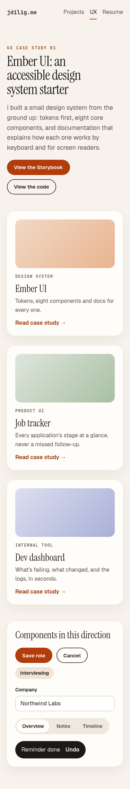
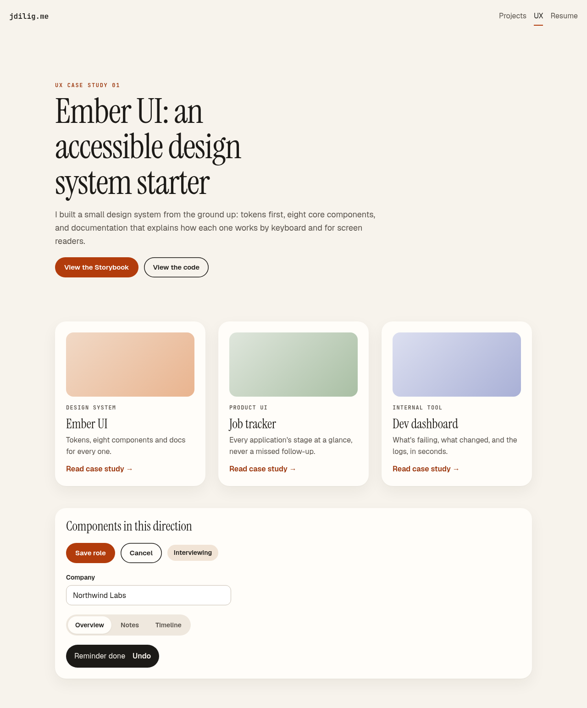
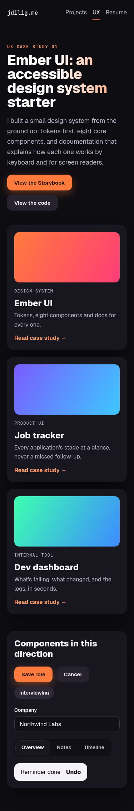
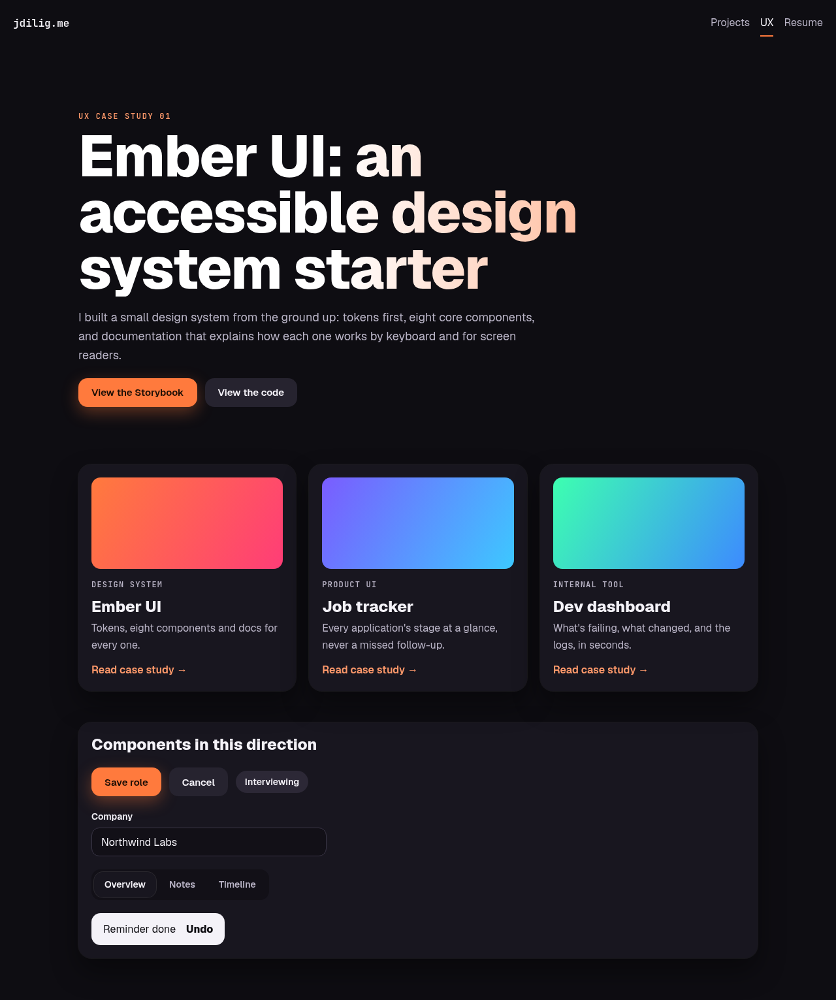
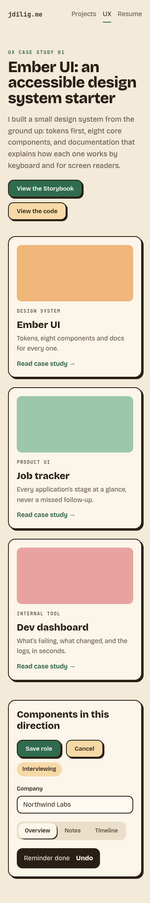
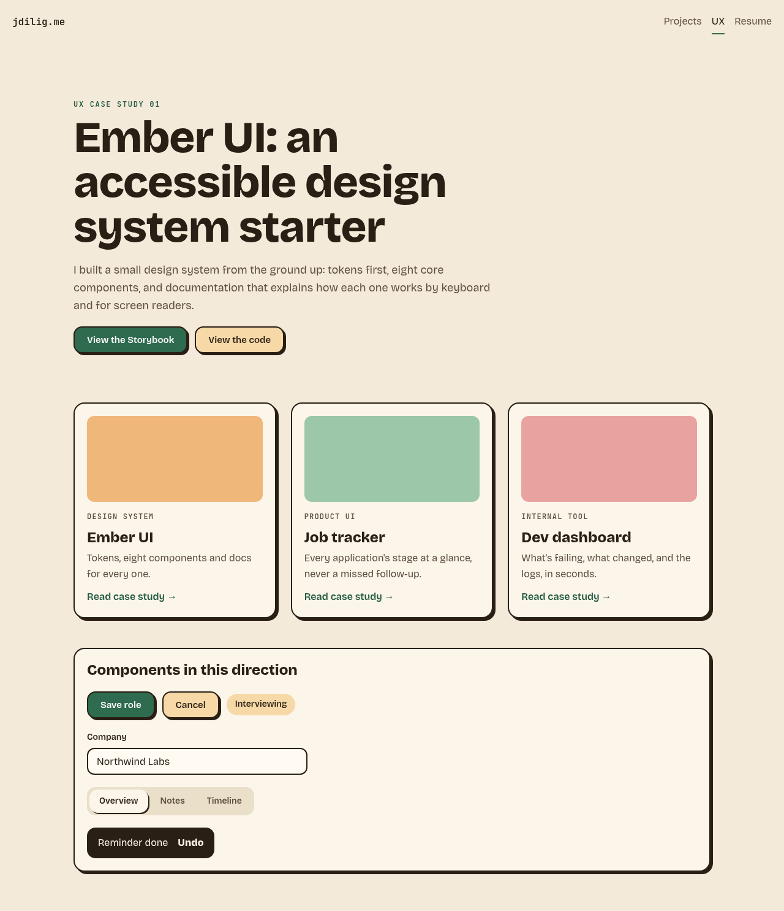

# Visual directions for the UX section (pick one)

John asked (2026-11-10) for less boxy, less stiff options. Three directions, each shown mobile-first at 375px and on desktop at 1280px, using the same real content: the Ember UI hero, the three UX case-study cards and a component sample. All three pass axe with 0 serious or critical issues and have no horizontal overflow at 375px. Motion only runs under `prefers-reduced-motion: no-preference`. Open the `.html` files for the live mockups.

| Token | A. Soft editorial | B. Bold with motion | C. Warm and tactile |
|---|---|---|---|
| Mood | Calm, magazine-like, lots of air | Dark, high-energy, gradients, hover lift | Friendly, hand-made, chunky offset shadows |
| Display type | Instrument Serif 400, up to 76px | Geist 800, up to 88px, gradient text | Bricolage Grotesque 800, up to 72px |
| Body type | Geist 16/1.6 | Geist 16/1.6 | Bricolage Grotesque 16/1.6 |
| Radius | Cards 24, buttons pill, inputs 12 | Cards 20, buttons 14, inputs 12 | Cards 18, buttons 14, inputs 12 |
| Elevation | Soft diffuse shadow, no borders | Hairline glow + deep shadow; accent glow on primary | 2px ink border + 4px solid offset shadow; buttons press in |
| Spacing | Card padding 24, gap 28, hero 48 / 96 | Card padding 20, gap 20, hero 40 / 88 | Card padding 20, gap 24, hero 40 / 80 |
| Color | Warm paper #f7f3ec, ember #b23c0c | Near-black #0e0d12, ember #ff7a3d | Oat #f3ead9, forest #2f6b4f, ink #2a1f14 |

## A. Soft editorial
Mobile | Desktop
---|---
 | 

## B. Bold with motion
Mobile | Desktop
---|---
 | 

## C. Warm and tactile
Mobile | Desktop
---|---
 | 
