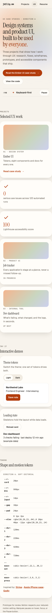
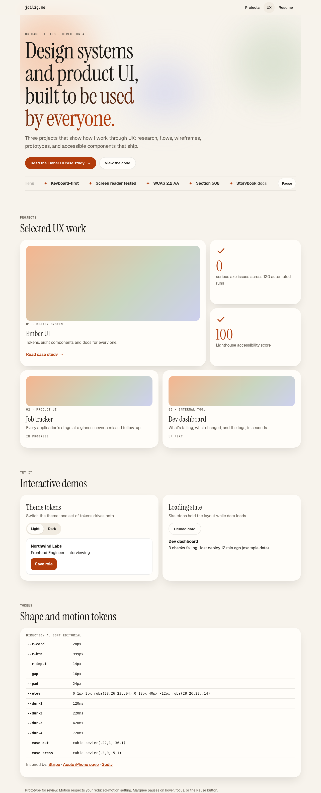
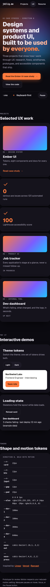
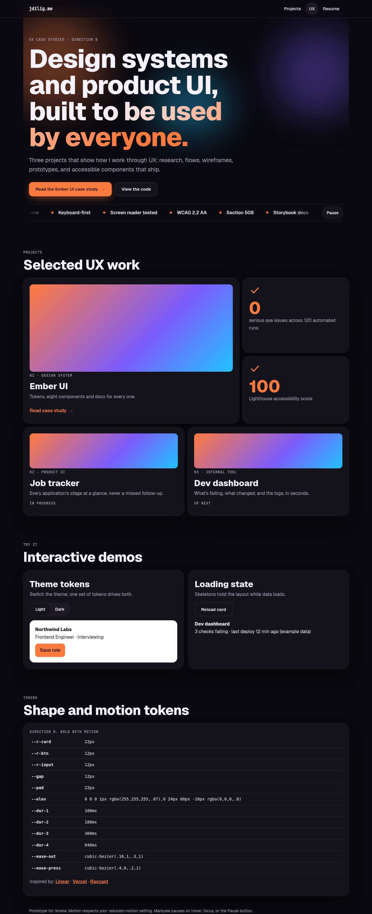
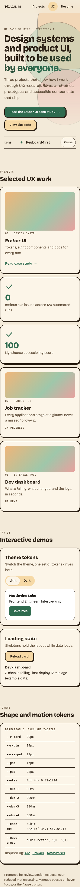
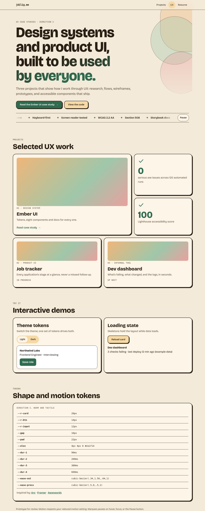

# Visual directions v2: modern, motion, accessible (pick one)

John's notes (2026-11-10): less boxy, more like modern web design; add animation, transitions and interactivity (parallax, marquee, ticker, animated icons); keep it accessible; meet government requirements such as Section 508.

Each direction is a **live, clickable prototype**. Open it on your phone and on desktop:

| Direction | Live prototype | Inspired by |
|---|---|---|
| A. Soft editorial | [Open A](https://raw.githack.com/balbonits/a11y-design-system/main/docs/directions/v2/a-editorial.html) | [Stripe](https://stripe.com), [Apple iPhone page](https://www.apple.com/iphone/), [Godly](https://godly.website) |
| B. Bold with motion | [Open B](https://raw.githack.com/balbonits/a11y-design-system/main/docs/directions/v2/b-bold.html) | [Linear](https://linear.app), [Vercel](https://vercel.com), [Raycast](https://www.raycast.com) |
| C. Warm and tactile | [Open C](https://raw.githack.com/balbonits/a11y-design-system/main/docs/directions/v2/c-tactile.html) | [Arc](https://arc.net), [Framer](https://www.framer.com), [Awwwards](https://www.awwwards.com) |

## What to try in each prototype
- **Route transition:** "Read the Ember UI case study" crossfades to the case-study view (View Transitions API, instant fallback); "All projects" goes back.
- **Parallax:** soft background shapes drift at different depths as you scroll.
- **Ticker / marquee:** skills scroll under the hero, with a **Pause** button; it also pauses on hover and keyboard focus.
- **Scroll reveal:** sections fade and rise into view.
- **Animated icons:** check marks draw themselves in when their tile appears (SVG).
- **Hover and press:** buttons lift on hover and press in on tap; project tiles lift and a sheen crosses the thumbnail.
- **Interactive demos:** a token-driven light/dark switch, and "Reload card" showing a skeleton loading state.
- **Layout:** bento grid instead of equal rigid boxes, fluid type, frosted (blurred) sticky nav.

## Motion tokens
| Token | A. Soft editorial | B. Bold with motion | C. Warm and tactile |
|---|---|---|---|
| `--dur-1` press | 120ms | 100ms | 90ms |
| `--dur-2` hover, toggles | 220ms | 180ms | 200ms |
| `--dur-3` route, tiles | 420ms | 360ms | 380ms |
| `--dur-4` reveal, icon draw | 720ms | 640ms | 600ms |
| `--ease-out` | `cubic-bezier(.22,1,.36,1)` calm | `cubic-bezier(.16,1,.3,1)` snappy | `cubic-bezier(.34,1.56,.64,1)` springy |
| `--ease-press` | `cubic-bezier(.3,0,.5,1)` | `cubic-bezier(.4,0,.2,1)` | `cubic-bezier(.5,0,.5,1)` |
| Ticker loop | 28s linear | 28s linear | 28s linear |

## Shape tokens
| Token | A | B | C |
|---|---|---|---|
| Card radius | 28px | 22px | 20px |
| Button radius | pill | 12px | 14px |
| Elevation | soft diffuse shadow | hairline + deep shadow, accent glow | 2px ink border + 4px offset solid shadow |
| Grid gap / card padding | 16 / 24 | 12 / 22 | 16 / 22 |
| Display type | Instrument Serif | Geist 800 | Bricolage Grotesque 800 |
| Fluid H1 | `clamp(2.6rem, 1.6rem + 5.2vw, 5.6rem)` | same | same |

## Accessibility and Section 508
Section 508 incorporates WCAG 2.0 Level AA; these target WCAG 2.2 AA, which covers it.
- `prefers-reduced-motion: reduce`: ticker stops and shows static text, parallax stays still, reveals and icons show immediately, shimmer stops, route changes are instant. Verified by script on all three.
- WCAG 2.2.2 Pause, Stop, Hide: visible Pause/Play button (`aria-pressed`) plus pause on hover and focus. Verified the button pauses it.
- 2.3.1 Three flashes: nothing flashes; only slow translation and fades.
- Decorative motion (background shapes, sheen, icons, duplicated ticker text) is `aria-hidden`.
- Skip link, visible focus rings, 44px+ tap targets, labelled keyboard-scrollable token table, `aria-live`/`aria-busy` on the loading demo, focus moves to the case-study heading after the route change.
- Performance: only `transform` and `opacity` animate; parallax uses `requestAnimationFrame` and a passive scroll listener.
- Checked: axe 0 violations and 0 horizontal overflow at 375px and 1280px for all three.

## Screenshots
| | Mobile 375 | Desktop 1280 |
|---|---|---|
| A |  |  |
| B |  |  |
| C |  |  |

The loading demo's dashboard text is example data. v1 static mockups are in the parent folder.
